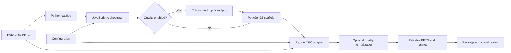
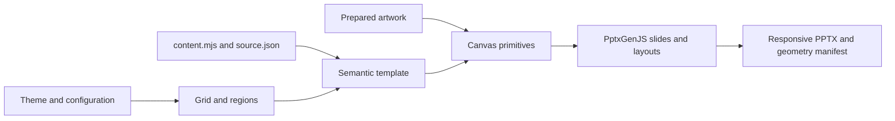
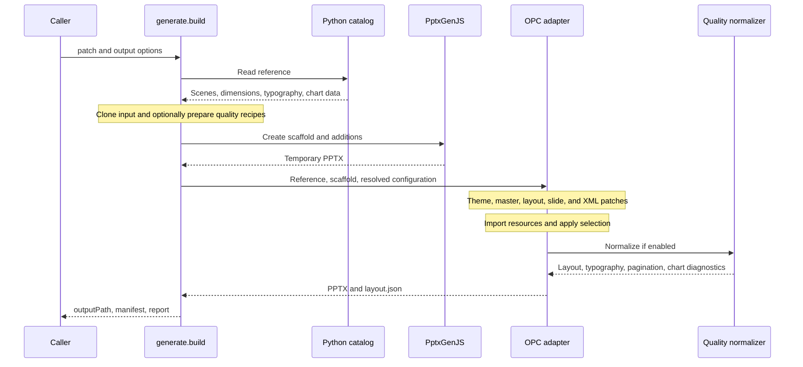
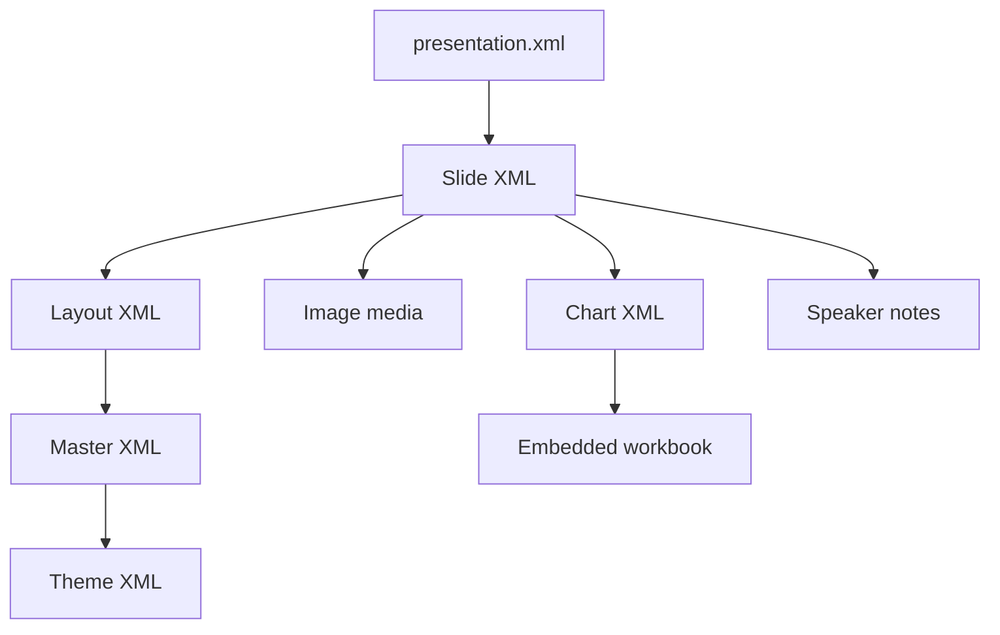

# Architecture

[Documentation index](README.md)

## Design

PptxGenJS authors new editable objects but does not import arbitrary presentations without loss. The native engine preserves the original PPTX package and selectively edits DrawingML. A real PptxGenJS scaffold supplies new objects and metadata; the Python adapter imports additions together with their resources and relationships.

The separate responsive engine uses semantic data and newly authored layouts. It does not retain the original slide object tree.

## Module responsibilities

| File | Responsibility |
| --- | --- |
| [generate.mjs](../src/generate.mjs) | Native build API, CLI, scaffold, additions, SVG override preparation |
| [fidelity-config.mjs](../src/fidelity-config.mjs) | Native configuration contract in JSDoc |
| [quality.mjs](../src/quality.mjs) | Defaults, source-specific recipes, roles, addition overrides |
| [responsive.mjs](../src/responsive.mjs) | Seven-slide build and artwork preparation |
| [theme.mjs](../src/theme.mjs) | Responsive branding, defaults, merge, validation |
| [layout.mjs](../src/layout.mjs) | Grid, inset, weighted splits, wrapping, relative boxes |
| [components.mjs](../src/components.mjs) | Measurement, Canvas, tables/charts, composites |
| [templates.mjs](../src/templates.mjs) | Regions, chrome, semantic renderers, reusable layouts |
| [content.mjs](../src/content.mjs) | Extracted content mapped to semantic schemas |
| [dependencies.mjs](../src/dependencies.mjs) | Local npm resolution and optional Codex fallback |
| [native_deck.py](../scripts/native_deck.py) | Catalog, inheritance/transforms, patches, OPC resource import |
| [quality_deck.py](../scripts/quality_deck.py) | Typography, fitting, pagination, native table sizing, diagnostics |
| [layout_constraints.py](../scripts/layout_constraints.py) | Dynamic boxes, footer limits, padding, linked cards/icons/markers |
| [chart_compat.py](../scripts/chart_compat.py) | Embedded workbook portability and range repairs |
| `scripts/review_*.py`, `verify.py`, `visual_review.py` | Output checks and renderer evidence |

## Native lifecycle

Temporary catalogs, scaffolds, serialized configurations, and SVG fallback files are removed. The final package is written through a temporary `.writing.pptx`. The adapter rejects overwriting the reference.

## Native resource graph

`.rels` files connect these parts. Chart XML alone is insufficient: the workbook, targets, and content types must travel with it. Import names are remapped to avoid collisions. Chart/picture overrides receive private resources so another instance is not modified accidentally.

Nested groups introduce coordinate transforms. The catalog resolves global inch-based boxes while retaining parent IDs and local transforms. Native `localBox` edits use parent-space EMU coordinates; global `box` edits are transformed back to local coordinates. Moving a group and moving one child have different effects.

## Data ownership

| Location | Purpose |
| --- | --- |
| Reference PPTX | Original content, artwork, relationships, layouts, and masters |
| `data/catalog.json`, `data/slides/NNN.json` | Extracted scenes, typography, geometry, IDs, and inheritance |
| `data/templates.json` | Variants `source-001` through `source-071`, pointing to native layout/master parts |
| `data/source.json`, `data/chart-source.json` | Semantic extraction and original chart data |
| `data/font-metrics.json` | Arial character advances for deterministic measurement |
| `assets/` | Extracted artwork, not slide screenshots |
| `config*.json` | Build profiles and user overrides |
| `output/` | Generated decks, assets, manifests, and review artifacts; ignored by Git |

Quality recipes use source wording and numbers. The catalog is evidence and input, not an independent renderer.

## Boundaries

Responsiveness happens during generation. Native fidelity does not reflow every original object when the grid changes. Quality adds explicit rules for known structures. Responsive templates calculate their own regions and collections, with finite capacity. Reader-specific font metrics and chart behavior still require [visual validation](validation.md).
