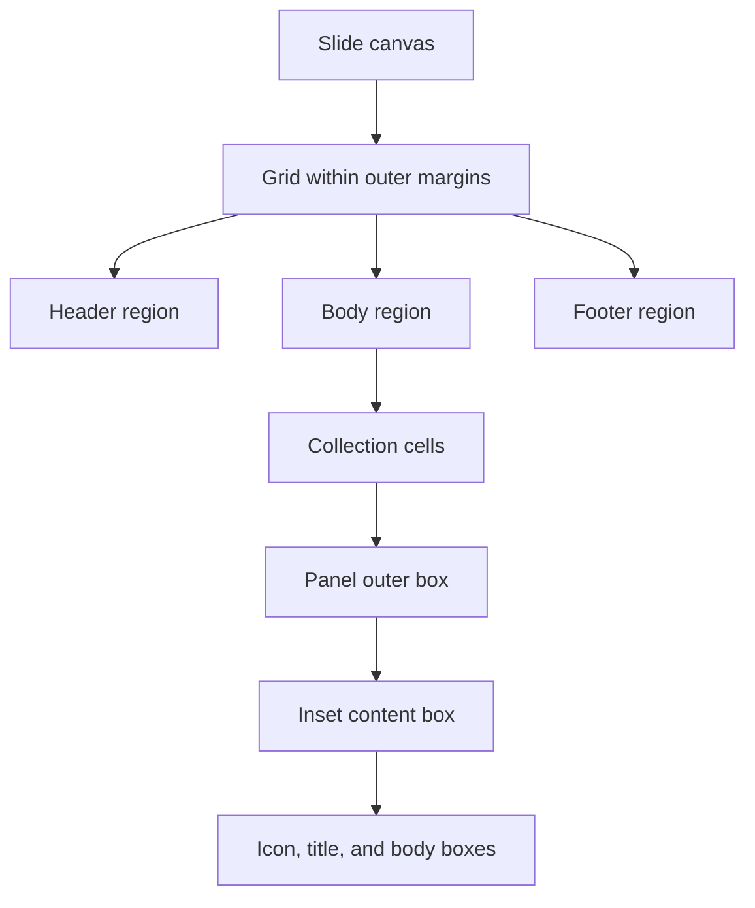

# Component and layout API

[Documentation index](README.md) · [Templates](templates.md) · [Responsive configuration](responsive-guide.md)

The reusable drawing API lives in [components.mjs](../src/components.mjs); geometry helpers live in [layout.mjs](../src/layout.mjs). The module also exports `root`, the absolute repository root used to resolve assets and data. These components primarily serve responsive templates. Quality recipes instead produce declarations consumed by the native scaffold and normalizer.

## Coordinate contract

A `Box` is `{x,y,w,h}` in inches. Font and line sizes are points. Regions describe available space; components derive child boxes from them. Geometry is computed when generating the presentation.



## Geometry helpers

### `new Grid(box, options = {})`

| Parameter | Default | Description |
| --- | --- | --- |
| `box` | Required | Positive region occupied by the grid |
| `columns`, `rows` | 14, 9 | Positive integer track counts |
| `gapX`, `gapY` | 0.12, 0.10 | Physical gaps in inches |

The constructor computes `cw = (w - (columns - 1) * gapX) / columns` and the corresponding row height. Invalid regions, counts, or gaps throw.

`grid.cell(col,row,colSpan=1,rowSpan=1)` returns a box. Indices start at zero; fractions are allowed. Position is `x + col * (cw + gapX)` and width is `colSpan * (cw + gapX) - gapX`. The requested cell must stay inside the grid.

`grid.flow(items)` returns new items with a computed `box`. Each item can specify `colSpan` and `rowSpan`, defaulting to 1. It fills left to right, wraps using the tallest span of the current row, and throws if the grid cannot contain the result. Inputs are not mutated.

### Other exported helpers

| Function | Parameters | Return / behavior |
| --- | --- | --- |
| `inset(box,pad)` | Number or `{top,right,bottom,left}` in inches; omitted edges are zero | Smaller box; throws if no positive inner area remains |
| `split(box,weights,axis='x',gap=0.12)` | Positive weights; axis `x` or `y` | Boxes that fill the region after subtracting gaps |
| `wrap(box,count,options={})` | `minWidth=1.8`, `gap=0.12`, `maxColumns=count` | Equal cells in reading order; last row retains column widths |
| `relative(box,x,y,w,h)` | Fractional coordinates and dimensions | Converts fractions to global inch-based box; does not independently validate bounds |

For `wrap`, columns are `min(count,maxColumns,max(1,floor((box.w+gap)/(minWidth+gap))))`; rows are `ceil(count/columns)`.

```js
import { Grid, inset, split } from './src/layout.mjs';

const grid = new Grid({ x: 0.56, y: 1.4, w: 12.21, h: 5.2 });
const card = grid.cell(0, 0, 4, 4);
const inner = inset(card, 0.12);
const [heading, body] = split(inner, [1, 4], 'y', 0.08);
```

Examples importing `./src/...` assume execution from a root-level module or root `node --input-type=module` session.

## Measurement and font fitting

| Function | Parameters / defaults | Return |
| --- | --- | --- |
| `textLines(value,width,size,bold=false,safety=1.05)` | Text or runs, width in inches, size in points | Estimated wrapped line count |
| `textHeight(value,width,size,options={})` | `bold`, `safety`, `leading=1.16`, `paraSpaceAfter=0` points | Estimated height in inches; nonpositive width returns infinity |
| `fitText(value,box,options={})` | `fontSize=10.5`, `minFontSize=7`, plus measurement options | Largest tested size that fits, reducing by 0.25 pt; throws if minimum cannot fit |

Measurement uses extracted Arial character advances, words, explicit newlines, and long-word splitting. It is preventive estimation, not the reader's layout engine. Rich runs are flattened for basic measurement; mixed run styles can require additional safety or visual review.

## Canvas lifecycle

`new Canvas(pptx,slide,config,number,assets,manifest)` binds one slide to its resolved configuration. `number` is the source number. `assets` maps asset keys to `{path,width,height}`. `manifest` is the mutable array receiving the finished slide record.

`options(kind,id,local={})` recursively merges:

1. The method's local options.
2. `config.components[kind]`.
3. `config.slides[number].components[kind]`.
4. `config.elements["number.id"]`.

Arrays replace rather than append. `record(id,box,extra={})` checks finite geometry, nonnegative dimensions, and slide bounds with a 0.001-inch tolerance; it returns and stores the entry. Zero dimensions are allowed for lines.

`finish()` appends `{sourceNumber,elements}` to the manifest. With debug enabled, it also outlines recorded text boxes. Call it once after rendering each slide.

### `canvas.text(id,value,box,style={})`

| Option | Default / behavior |
| --- | --- |
| `text` | Replaces `value` when supplied |
| `box` | Merges over the calculated box |
| `visible` | `false` skips this primitive |
| `padding` | Optional number or edge object in inches; applied before fitting |
| `fontSize` | `theme.type.body` (10.5 pt by default) |
| `minFontSize` | 6.5 pt for this method |
| `fontFace`, `color` | Theme body font and text color |
| `leading` | Rendered line spacing defaults to 1.10; measurement defaults to 1.16 unless explicit |
| `safety`, `bold`, `paraSpaceAfter` | Measurement controls; paragraph spacing is points |
| Other style options | Forwarded to PptxGenJS after internal helper keys are removed |

It fits text, draws with zero native margin, and records text, chosen font size, inner box, and estimated height. Default vertical alignment is top. Native object name is `number.id`. An empty string is valid. Impossible fitting throws rather than truncating.

### Shape, line, and image methods

| Method | Parameters and behavior |
| --- | --- |
| `shape(id,box,style={})` | Kind `shape`; default `type:'rect'`, theme border/thin line, transparent paper fill. Supports box and visibility overrides. |
| `line(id,x1,y1,x2,y2,options={})` | Delegates to shape with type `line`; uses nonnegative bounds and `flipV` for the diagonal direction. Options configure the line. |
| `image(id,asset,box,options={})` | Kind `image`; asset is a prepared-map key, overridable by `asset`. Contains and centers artwork without distortion. Unknown keys throw. Empty asset or `visible:false` skips. |

Images record the requested region, although their actual contained rectangle can be smaller. Icons rendered as images are scalable artwork, not individually editable Office geometry.

## Rich paragraphs

`richParagraphs(paragraphs,{headingColor,bullet=true}={})` returns PptxGenJS text runs. Each paragraph requires a `runs` array; extracted paragraphs also provide `text`, `level`, and `bullet`. Extracted runs have `text` and `style`, including `b`, `i`, `color`, and `baseline`; positive baseline becomes superscript. Paragraph boundaries become newlines. Optional bullet prefixes are literal bullet characters and indentation. Source red values can be mapped to `headingColor`.

## Native table component

`table(canvas,id,values,box,options={})` authors a PowerPoint table and returns `{widths,heights}`. `values` is a rectangular string matrix including its header when enabled.

| Option | Default | Meaning |
| --- | --- | --- |
| `values` | Argument | Replace matrix |
| `weights` | Equal columns | Relative widths, normalized to box width |
| `fontSize`, `minFontSize` | 10, 7 pt | Shared size fitting in 0.25-point steps |
| `padding` | 0.045 in | Cell padding; converted to points for PptxGenJS |
| `header` | true | First row uses header formatting |
| `headerFill`, `headerColor` | Primary, paper | Header colors |
| `rowStyles` | `{}` | Per-row formatting keyed by zero-based row |
| `cellStyles` | `{}` | Per-cell formatting keyed by `row.column`; overrides row style |
| `align` | First column left, others center | `left` selects left alignment across columns |
| `box`, `visible` | Calculated / visible | Region override or skip |
| `pptx` | `{}` | Additional PptxGenJS table options |

Row minima are measured using all cells, useful width after padding, bold header/style, leading 1.12, and safety 1.07. A uniform font is reduced until rows fit. Spare height is distributed across rows. `autoPage:false` prevents reader/library pagination. Impossible minimum sizing throws. Skipping returns empty width/height arrays. Records include row/column counts, font size, row heights, and text.

## Composite components

### `collection(canvas,id,items,box,options,render)`

Uses `wrap` and calls `render(item,itemBox,childId,resolvedOptions)` in reading order. Child IDs are `id.0`, `id.1`, and so on. Options: `minWidth=1.8`, `gap=theme.spacing.gap`, `maxColumns=items.length`, and optional `minColumnSpan`. The latter caps columns by `floor(config.grid.columns/minColumnSpan)`. `box` can replace the available region. It does not automatically skip the entire composite for `visible:false`; hide its primitives or make that behavior explicit in a renderer.

### `panel(canvas,id,box,title,options={})`

Draws a framed panel, colored header bar, and centered title. Returns the inset body box below the header.

| Option | Default |
| --- | --- |
| `padding` | Theme padding, 0.12 in |
| `headingRatio` | 0.065 of outer height |
| `headingFontSize` | 11 pt |
| `frame`, `bar`, `title` | Nested style overrides for child primitives |

Child IDs are `.frame`, `.bar`, `.title`. Header title inset is 0.05 in horizontally and 0.025 in vertically. Body padding is independent of the header inset.

### `donut(canvas,id,series,box,options={})`

Creates a native doughnut with `series:{labels,values}` and returns the effective series. Component kind is `chart` for override lookup. Defaults: `holeSize=53`, `firstSliceAng=270`, `fontSize=8.5`; options also accept `series`, `box`, `visible`, and `pptx`.

The dashboard uses three metric slices plus a white spacer. Colors are complete, in-progress, not-started, and paper. Legends/data labels are hidden by default; dashboard text displays the first three values separately. Changing this chart's series keeps those displayed values synchronized. Supply a spacer equal to the visible total to retain a semicircle.

### `labelBody(canvas,id,title,body,box,options={})`

Splits a region vertically with a 0.04-inch gap. Defaults: `titleRatio=0.18`, `titleFontSize=10`, `fontSize=10`. Draws `.heading` and `.body`; nested `heading` and `body` options customize their text styles. Heading is bold, with optional `color`.

## Working example

Inside a semantic renderer with an existing `Canvas c`:

```js
import { collection, panel, labelBody } from './src/components.mjs';

collection(c, 'benefits', [
  { title: 'Clarity', body: 'Use a shared hierarchy.' },
  { title: 'Consistency', body: 'Reuse spacing tokens.' },
], availableBox, { minWidth: 2.2, gap: 0.12 }, (item, box, id) => {
  const body = panel(c, id, box, item.title, { headingRatio: 0.18 });
  labelBody(c, `${id}.content`, 'Benefit', item.body, body);
});
```

Stable child IDs make every primitive configurable. Outer and inner boxes must remain large enough for the selected hierarchy. A token cannot create unlimited space; adjust layout or split content when minimum text sizes no longer fit.
