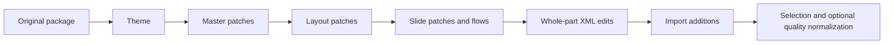

# Native configuration reference

[Documentation index](README.md) · [Quality profile](quality.md) · [Responsive configuration](responsive-guide.md)

This contract applies to native fidelity, including quality-profile builds. Start with [config.fidelity.example.json](../config.fidelity.example.json). Responsive mode has a separate schema.

## Top-level parameters

| Parameter | Type / default | Behavior |
| --- | --- | --- |
| `source` | Local path / reference filename | Source package, resolved from the repository root |
| `mode` | `fidelity` or `responsive` / `fidelity` | CLI routing; removed before calling the selected build |
| `selection` | Unique source numbers / all slides | Output selection and order; source IDs remain stable |
| `showHidden` | Boolean / false | Makes hidden source slides visible |
| `grid` | Object / 14 columns, 9 rows | Tracks for explicit grid edits and additions |
| `theme` | Object | Native color/font substitutions |
| `masters` | Map keyed by `slideMasterN` | Edits native master parts |
| `templates` | Map keyed by `slideLayoutN` | Edits native layout parts |
| `slides` | Map keyed by source number | Element edits, flows, background, hidden state |
| `elements` | Map keyed by `source.eID` | Direct native patches; replace matching slide-level patches |
| `additions` | Map of source number to declarations | New PptxGenJS objects |
| `nativeParts` | Map of OPC XML path to operations | Advanced whole-part XML edits |
| `quality` | Object / absent | Enables [quality normalization](quality.md) |
| `slide` | Exact source dimensions | Native mode rejects canvas changes |

Unknown top-level, owner-level, element, text-style, and flow keys are rejected by their validators. This is not a complete schema validator for arbitrary PptxGenJS options.

`grid.columns` and `grid.rows` are positive integers. `gapX`, `gapY`, `marginX`, and `marginY` are inches; native addition defaults are zero. Changing the grid does not snap preserved objects to new tracks.

## Find an element

Inspect `data/slides/050.json` for source slide 50 or the exported `.layout.json` for final geometry. IDs such as `e25` are native nonvisual object IDs, not array indices. `parentId` identifies group membership; `inheritedFrom` identifies inherited geometry. Layout/master IDs belong to their respective parts.

```json
{
  "selection": [5, 10, 50],
  "elements": {
    "5.e5": {
      "text": "Updated executive summary",
      "textStyle": { "fontSize": 19, "color": "EC111A", "align": "left" },
      "grid": { "col": 1, "row": 1, "colSpan": 11, "rowSpan": 1 }
    }
  }
}
```

## Order and precedence



Global `elements["5.e5"]` **replaces** the matching `slides["5"].elements.e5` patch; the two are not recursively merged. Flows calculate boxes before explicit element properties take precedence. Native Office inheritance gives directly styled slide objects precedence over inherited layout/master styling. Quality normalization runs afterward and can impose semantic typography tokens.

## Element patch parameters

| Parameter | Type / unit | Effect |
| --- | --- | --- |
| `text` | String | Replaces text using the first original style as a base |
| `textRuns` | Map of zero-based run index to string | Replaces selected runs |
| `textReplacements` | Map of old to new strings | Substitutes within runs; does not match across formatting boundaries |
| `textStyle` | Object | Supported text formatting below |
| `box` | `{x,y,w,h}` in inches | Global geometry; partial coordinates may be patched |
| `localBox` | Parent-space transform values in EMU | Local geometry for grouped/rotated objects |
| `grid` | `{col,row,colSpan,rowSpan}` | Zero-based placement; fractional tracks allowed |
| `rotation` | Degrees | Rotation |
| `visible` | Boolean | `false` removes the object |
| `fill` | Six-digit hex color | Solid fill |
| `line` | `{color,width}` | Line color and width in points |
| `shapeType` | DrawingML preset | Preset shape geometry |
| `name` | String | Selection-pane name |
| `table` | Object | Native table edits |
| `chart` | Object | Native chart data/XML edits |
| `image` | Path or `{path,fallback}` | Image resource replacement |
| `xmlPatches` | Array | Relative object XML operations |

`textStyle` accepts `fontFace`, `fontSize` in points, `bold`, `italic`, `color`, `align` (`left`, `center`, `right`, `justify`), `margin` in inches, `vertical` (`top`, `middle`, `bottom`), and `wrap` (boolean). Native text margin is distinct from PptxGenJS table padding in points. Bare fidelity mode does not measure or shrink edited text.

## Native flows

```json
{
  "slides": {
    "50": {
      "flows": [{
        "elements": ["e25", "e26", "e27", "e28"],
        "region": { "x": 1, "y": 2, "w": 5, "h": 4 },
        "minWidth": 2,
        "gap": 0.1,
        "maxColumns": 2
      }]
    }
  }
}
```

This moves the four texts, not their independent icons. Select existing group IDs to move grouped components. Do not include a group and its child together. Items read left to right, then top to bottom, in the supplied order.

| Option | Default |
| --- | --- |
| `elements` | Required nonempty, unique existing IDs |
| `region` | `{x:0.56,y:1.3,w:slide.width-1.12,h:slide.height-1.9}` |
| `minWidth` | 2 inches |
| `gap` | 0.12 inches |
| `maxColumns` | Number of elements |

Cells are equally sized. Available width determines columns; available height determines row height. Flow changes geometry, not font size or semantic associations.

## Tables

`table.rows` replaces the matrix while retaining column count. Additional rows clone the last row, and height is redistributed. Complex merges require specific review. Cell keys are `"row.column"`, zero-based and including the header.

```json
{
  "slides": {
    "10": {
      "elements": {
        "e8": {
          "table": {
            "cells": {
              "1.2": {
                "text": "Updated meeting",
                "fill": "F5EFE8",
                "textStyle": { "bold": true }
              }
            }
          }
        }
      }
    }
  }
}
```

`columnWidths` and `rowHeights` are inch-based arrays. Tables remain native editable tables. Quality mode subsequently measures text and enforces its font/padding rules.

## Charts

```json
{
  "elements": {
    "68.e114": {
      "chart": {
        "series": [{ "values": [2, 7, 2, 11] }],
        "xmlPatches": [{ "path": ".//c:holeSize", "attributes": { "val": "60" } }]
      }
    }
  }
}
```

Retain original series and point counts. An empty series patch `{}` preserves that series. Fields are `name`, `labels`, `values`, `xValues`, and `yValues`, depending on chart type. The adapter updates caches and workbook data with private resources for the edited instance. Quality also repairs workbook portability for Keynote.

Independent text boxes near a chart are separate elements; update them explicitly. In dashboard half-doughnuts, the fourth value is a white spacer equal to the sum of the first three values, not another metric.

## Branding and media

Native `theme.colors` supports `primary`, `surface`, `paper`, and `text`; `theme.fonts` supports `body` and `heading`. `colorMap` and `fontMap` replace exact values. Original themes and inheritance remain available. Color substitution does not recolor image pixels or automatically rewrite every literal recipe color.

Image replacement preserves crop, geometry, and effects. A string path ending in `.svg` receives a generated PNG fallback while retaining the vector. Supply `{path,fallback}` explicitly to manage both. Paths resolve from the repository root. Preserve aspect ratio when crop fidelity matters.

## Masters, layouts, and XML operations

`masters.slideMaster1` and `templates.slideLayout20` accept `elements`, `flows`, and `background`. Slide patches additionally accept `hidden`. Background is a hex color. IDs must exist in the selected part.

XML operations accept `path`, `attributes`, `text`, `remove`, and `appendXml`. Use relative ElementTree XPath and the appropriate `p:`, `a:`, or `c:` namespace. Inserted XML must declare namespaces. Removing the operation root is forbidden. `chart.xmlPatches` targets private chart XML; `nativeParts` targets an existing `.xml` or `.rels` part. Verify relationships and rendering after advanced edits.

## New editable additions

```json
{
  "selection": [50],
  "additions": {
    "50": [{
      "id": "review-label",
      "kind": "text",
      "text": "Review copy",
      "box": { "x": 10.5, "y": 6.6, "w": 2, "h": 0.2 },
      "style": { "fontFace": "Arial", "fontSize": 10, "color": "666666" }
    }]
  }
}
```

| Field | Meaning |
| --- | --- |
| `id` | Unique per slide; defaults to `addition-<index>` |
| `kind` | `text`, `shape`, `table`, `chart` |
| `box` / `grid` | Positive on-canvas region; grid takes precedence |
| `text` | String or PptxGenJS rich-text runs |
| `type` | Shape/chart type; defaults to `rect` / `bar` |
| `rows` | PptxGenJS table rows |
| `series` | PptxGenJS chart series |
| `style` | PptxGenJS options merged over default style and geometry |

Objects receive `custom.<id>` names. Bounds are validated before and after style merging. Additions cannot target unselected slides. They bypass responsive Canvas fitting; dense additions need explicit measurement or quality normalization.
