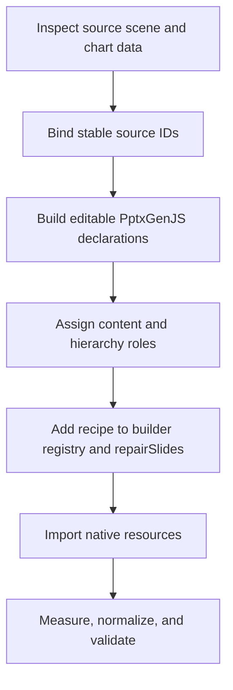

# Extending and maintaining the system

Use English for identifiers, comments, docstrings, diagnostics, interface copy,
test descriptions and documentation throughout the project.

[Documentation index](README.md)

Choose the extension point that matches the intended result. Use a native patch for a small change to existing content, a quality recipe for a source layout that needs recomposition, and a semantic template for reusable data-driven authoring.

## Add a responsive component

A component receives a `Canvas`, stable ID, data, available box, and options. Derive child boxes from the available box. Use tokens for repeated style choices, preserve reading order, and keep icon and text lanes separate.

```js
import { inset, split } from "./src/layout.mjs";

/**
 * Draws one reusable message card within an available region.
 * @param {Canvas} c Drawing context for the current slide.
 * @param {string} id Stable prefix used by child element overrides.
 * @param {{title:string,body:string}} data Card content.
 * @param {{x:number,y:number,w:number,h:number}} box Outer region in inches.
 * @param {object} options Local defaults, overridable through configuration.
 * @returns {void}
 */
export function messageCard(c, id, data, box, options = {}) {
  const o = c.options("messageCard", id, {
    padding: c.theme.spacing.padding,
    gap: c.theme.spacing.gap,
    titleWeight: 1,
    bodyWeight: 3,
    ...options,
  });
  const region = { ...box, ...o.box };
  c.shape(`${id}.background`, region, {
    fill: { color: c.theme.colors.surface },
  });
  const [titleBox, bodyBox] = split(
    inset(region, o.padding),
    [o.titleWeight, o.bodyWeight],
    "y",
    o.gap,
  );
  c.text(`${id}.title`, data.title, titleBox, {
    bold: true,
    fontSize: 12,
    minFontSize: 12,
  });
  c.text(`${id}.body`, data.body, bodyBox, {
    fontSize: 12,
    minFontSize: 10,
  });
}
```

The example is a pattern to integrate into a renderer, not an already registered component. Document the new option defaults and child IDs in [Components](components.md). If the composite supports `visible:false`, implement that explicitly before drawing children.

Use tests when the component introduces meaningful layout behavior: narrow regions, multi-line headings, minimum font failure, and changed item counts. A test should verify the layout rule rather than merely duplicate its implementation.

## Add a semantic template

1. Implement `(canvas,data,bodyBox)` in `src/templates.mjs` and register it in the exported `templates` map.
2. Define its structured content schema and defaults. Use `collection`, `split`, and `inset` to derive geometry.
3. Keep variable content in the renderer and static chrome in reusable layout/master configuration.
4. Register a content entry and update the responsive source loop if the template should become part of the standard build. The current loop is a fixed seven-element list.
5. Document data fields, component options, child IDs, and capacity behavior in [Templates](templates.md).
6. Generate, inspect the geometry manifest, and review the actual PPTX in the target reader.

Do not imply that adding a renderer automatically imports an arbitrary source slide. Source extraction and content mapping are separate responsibilities.

## Add a native quality recipe



Work in `src/quality.mjs`. Read source wording and numbers from the catalog; do not duplicate business values in another untracked data source. Use the existing text/table/chart declaration helpers, stable semantic IDs, and spacing tokens. Assign generated content roles with `source.custom.id`; use `quality.elements['source.id']` for declaration overrides.

The `prepareQuality` builder removes selected top-level source body objects and appends replacement declarations. Ensure removal does not discard notes, required relationships, or content that the new recipe omits. Native tables/charts must carry their full resource graph through the adapter. New shapes should have explicit geometry and fit the source canvas.

For linked source objects, prefer an explicit `flow` association over moving unrelated children independently. Extend `layout_constraints.py` only when an existing family cannot express the requirement. Document the binding schema and resulting audit fields. Avoid relying on symbol fonts for icons when editable native geometry is practical.

## Changing branding or typography

Responsive theme tokens, native theme substitutions, and quality tokens are separate settings. A brand change should inspect all three, including literal colors in recipes and rasterized artwork. Do not recolor official logos by bulk SVG replacement. Verify the intended font is installed in the rendering environment; another family invalidates assumptions based on Arial measurement.

A shared hierarchy token is preferable to many independent font overrides. New hierarchy roles must have a positive size and an explicit assignment. Content size ranges must satisfy `min <= size <= max`. Changing spacing requires reviewing available width and height, not only the visible gaps.

## Supporting another reference deck

Retain the old source until the new deck has its own catalog and review evidence. Extract and inspect source counts, layouts, masters, inherited geometry, hidden states, IDs, charts, and artwork. Replace source-specific mappings in `content.mjs`, quality recipes, and flow bindings. Update source-specific assertions in `verify.py` and tests. Record reader-specific results for the resulting artifact.

The API's `source` option changes the native input path; it does not migrate all source-specific logic automatically.

## Maintain the documentation

Keep README navigation, parameter tables, content schemas, and examples synchronized with executable defaults. The defaults snapshot can be refreshed from the root:

```sh
node --input-type=module <<'JS'
import fs from 'node:fs';
import { qualityDefaults } from './src/quality.mjs';
fs.writeFileSync('docs/reference/quality-defaults.json',
  JSON.stringify(qualityDefaults, null, 2) + '\n');
JS
```

Document each named function's purpose, inputs, units, defaults, return value, mutation behavior, and failure conditions. Keep new documentation and inline comments in English. Use Mermaid for compact architecture and lifecycle diagrams. Describe mode-specific limitations next to the affected feature.

Run `npm run docs:check` for inline coverage, check relative Markdown links, parse JSON examples, and verify names/defaults against source. For documentation-only changes, rerendering the full deck is unnecessary unless an executable example changes generator behavior or exposes a new issue.
