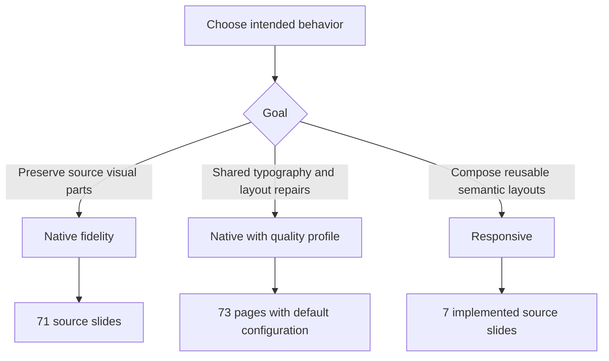

# Getting started

[Documentation index](README.md)

## Requirements

| Requirement | Used for |
| --- | --- |
| Node.js 24+, npm | ES modules, PptxGenJS, Sharp, AdonisJS API |
| Python 3 | Catalog extraction, package editing, normalization, verification |
| Reference PPTX in the project root | Full-deck source and extraction |
| Scotia / Scotia Headline fonts | Source and responsive brand typography |
| LibreOffice `soffice`, Poppler `pdftoppm`, Pillow | Optional PDF rendering and contact sheets |
| macOS, Keynote, `osascript` | Optional Keynote import and chart validation |

Core native builds use Python's standard library. Install Pillow in your Python environment for visual review. Renderers must be on `PATH`. [package.json](../package.json) declares PptxGenJS 4.0.1 and Sharp 0.35.5.

```sh
npm install
npm run build
npm run verify
```

Run commands from the project root. The dependency loader can also use Codex's bundled runtime when local modules are unavailable; `CODEX_NODE_MODULES` overrides that fallback directory. A normal npm installation is the conventional setup.

## Choose a build



```sh
# Reviewed full deck
npm run build

# Source-preservation baseline
npm run build:fidelity

# Reviewed deck under a separate filename
npm run build:quality

# Semantic templates with an explicit preview font
node src/generate.mjs --mode responsive --font Arial --show-hidden --output output/responsive-preview.pptx

# Native source selection in the specified order
node src/generate.mjs --slides 5,10,50 --output output/selected.pptx

# Custom quality output
node src/generate.mjs --config config.quality.json --output output/custom-quality.pptx
```

The default build and fidelity build use the same output filename. Supply `--output` to retain variants. Quality is opt-in in the bare CLI and JavaScript API; the default npm script opts in with `config.quality.json`.

## Inspect the output

Every build writes a PPTX and a sibling `.layout.json`. The manifest exposes source numbers, geometry, package changes, and quality diagnostics. Locate objects there before configuring them; output page number and source number are not interchangeable after pagination.

```sh
python3 scripts/verify.py output/custom-quality.pptx
python3 scripts/review_quality.py --source output/custom-quality.pptx --directory output/review/custom
python3 scripts/review_keynote.py --source output/custom-quality.pptx --directory output/review/custom-keynote
```

The last two commands require optional rendering dependencies. Keynote review opens a temporary copy, counts slides and native charts, exports a PDF, and closes only that copy. Inspect the pages as well as the counts.

## Refresh extracted data

```sh
npm run extract
npm run extract:responsive
```

`extract` refreshes native metadata and per-slide descriptors. `extract:responsive` refreshes the seven-slide semantic inputs and artwork. These commands update versioned data and are maintenance operations. Native builds also read a fresh catalog from their chosen source.

Another source deck is not automatically a drop-in replacement: source IDs, repair bindings, chart shapes, and semantic extraction indices may differ. See [Extending](extending.md).
