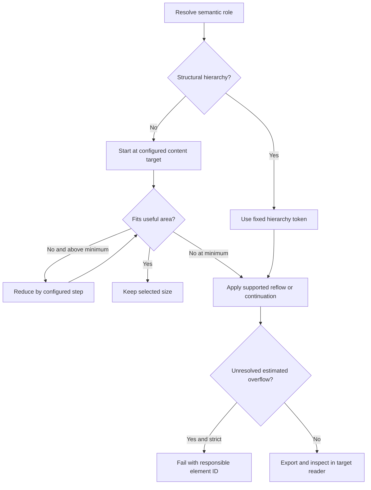
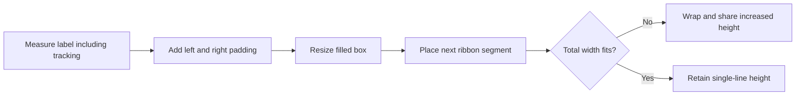

# Quality, typography, and layout consistency

[Documentation index](README.md) · [Native configuration](configuration.md) · [Complete defaults](reference/quality-defaults.json)

Quality is enabled by passing `quality:{}` to the native build or by loading [config.quality.json](../config.quality.json). It preserves native objects while normalizing typography and applying explicit layout repairs. The bare fidelity build leaves this profile disabled.

## Configuration surface

| Parameter under `quality` | Default | Purpose |
| --- | --- | --- |
| `font` | `Arial` | Materialized font family for normalized text |
| `type` | Role limits below | Content size targets and permitted ranges |
| `hierarchy` | Enabled; shared size map | Structural typography tokens and explicit element roles |
| `referenceTypography` | Enabled; `elements:{}` | Original typography metadata and per-element reference settings |
| `fontFit` | `{enabled:true,step:0.25}` | Controlled shrinking for content |
| `spacing` | Tokens below | Shared margins, gaps, padding, and line spacing |
| `flow` | Enabled; source-specific bindings | Dynamic geometry and linked-element layout |
| `repairSlides` | `[10,23,29,31,34,40,58,65]` | Recomposition builders to execute |
| `elements` | `{}` | Overrides for generated repair declarations |
| `roles` | `{}` plus built-in dense roles | Content-role assignments keyed by `source.objectId` |
| `strict` | true | Fail on unresolved estimated text overflow |
| `paginationSafety` | 1.12 | Measurement reserve for summary continuations |

Objects merge recursively with defaults; arrays replace entirely. The [defaults snapshot](reference/quality-defaults.json) includes every built-in binding. [quality.mjs](../src/quality.mjs) is the executable source of truth; regenerate the snapshot after changing it.

## Content scale and structural hierarchy

| Content role | Minimum | Target | Maximum |
| --- | ---: | ---: | ---: |
| `title` fallback | 22 | 22 | 24 |
| `body` | 12 | 12 | 16 |
| `dense` | 10 | 10 | 12 |
| `note` | 8 | 8 | 9 |

All values are points. Dense roles cover tables, charts, matrices, diagrams, and compact figure labels. The range must satisfy `0 < min <= size <= max`. The target is used when it fits; free space does not automatically grow content to the maximum. With the default body range, body text cannot shrink below its 12-point target. To allow a 14-point target to shrink to 12, configure that explicitly.

```json
{
  "quality": {
    "type": { "body": { "min": 12, "size": 14, "max": 16 } },
    "fontFit": { "enabled": true, "step": 0.25 },
    "strict": true
  }
}
```

Structural text follows `hierarchy.sizes`, rather than the body range:

| Token | Points | Use |
| --- | ---: | --- |
| `coverTitle` | 60 | Opening cover title |
| `sectionCoverTitle` | 66 | Section divider title |
| `coverNumber` | 28 | Divider numbering |
| `title` | 22 | Main slide title |
| `subtitle` | 14 | Structural subtitle |
| `section` | 11 | Section heading |
| `component` | 12 | Card/component heading |
| `chartTitle` | 10 | Compact chart heading |
| `tableHeader` | 10 | Native table header |
| `kicker` | 10 | Top-level ribbon/section label |
| `statement` | 16 | Highlight statement |
| `display` | 18 | Strategic pillar display text |

The hierarchy is derived from reference roles and then standardized. Original sizes remain in the catalog for audit. Explicit role assignments use `quality.hierarchy.roles["50.e25"]` or `quality.hierarchy.roles["65.custom.card-title-0-0"]`. Structural tokens do not silently shrink to body size. To create an intentional exception, add a named token and assign that role.

```json
{
  "quality": {
    "hierarchy": {
      "sizes": { "component": 12, "specialHeading": 13 },
      "roles": { "65.custom.card-title-0-0": "specialHeading" }
    }
  }
}
```

Disabling hierarchy while keeping `referenceTypography.enabled:true` uses individual reference sizes. Disabling both uses the generic scale. Cover detection accounts for body placeholders: reference text at least 48 pt below 2 inches is classified as cover text, avoiding accidental conversion to 12-point body text. Cover height can grow for wrapping; blank title paragraphs are removed. Layout placeholders receive matching cover tokens.

## Fitting lifecycle



The diagram describes the policy; implementation includes both preventive recipe measurements and post-import normalization. Tables fit as a unit to preserve a shared font size. Text is not truncated. Structural layouts must make room for their fixed hierarchy. `strict:false` exports diagnostic pending overflow in `quality.estimatedOverflow`; it is not the delivery default.

Measurement uses Arial advances, explicit line breaks, margins, paragraphs, merged table cells, and useful width. Another font family requires fresh visual review. Estimated fit is not proof against every type of collision or every reader's metrics.

## Spacing and dynamic boxes

| Token | Default | Unit |
| --- | ---: | --- |
| `spacing.marginX` | 0.56 | inches |
| `spacing.gap` | 0.12 | inches |
| `spacing.padding` | 0.08 | inches |
| `spacing.tablePadding` | 2 | points |
| `spacing.leading` | 1.1 | multiplier |
| `flow.boxPadding` | 0.06 | inches |
| `flow.panelPadding` | 0.12 | inches |
| `flow.footer.top` | 6.80 | inches |
| `flow.footer.bottom` | 7.32 | inches |
| `flow.footer.gap` | 0.14 | inches |

The planner reserves a footer region and also accounts for the inherited logo's actual top edge. Notes receive measured height and a width ending before the logo. Content must end above the reserved area with the configured gap. Auxiliary labels are registered with `flow.footer.auxiliary`, for example `"65":["custom.appendix"]`.



The Mexico ribbon uses measured text width plus padding, without preserving the old width as a minimum. WEALTH, ALL BANK, and COUNTRY OVERVIEW therefore occupy different widths. Vertical labels grow along their reading axis. Separate filled containers receive inset content geometry; shapes carrying their own text receive explicit text margins, avoiding double padding. Larger panels use `panelPadding`; compact boxes use `boxPadding`. Tables keep their own point-based padding.

## Source-specific flow families

These declarations bind existing IDs; they are not automatic semantic detection for arbitrary new decks. Arrays and bindings are fully enumerated in the defaults snapshot and root configuration.

| `flow` section | Parameters and behavior |
| --- | --- |
| `enabled` | Enables geometry planning before typography normalization |
| `stacks[source]` | Array of `{ids,right}`; measures ordered row blocks and moves linked elements within the right boundary |
| `tableHeaders['source.id']` | `{minHeight,anchor}`; reserves header space, e.g. `38.e9` has 0.72 in and DrawingML anchor `b` |
| `tableIcons['source.objectName']` | `{column,textColumn,prefix,size,gap,kinds,enabled}`; zero-based icon/text columns, square icon size, fixed gap, optional per-row symbols |
| `panels[source]` | `padding`, `gap`, `paragraphGap`, `markerLane`, `markerGap`, `markerSize`, `panels`, `legend`, `labels` |
| `cards[source]` | `group`, `bannerGroup`, `banner`, `bannerTop`, `bannerHeight`, `padding`, `compactPadding`, `internalGap`, `badgeSize`, `badgeGap`, `gap`, `columns`, `cards` |
| `iconCards[source]` | `padding`, `gap`, `paragraphGap`, `iconSize`, `cards` with `body`, `icon` IDs and optional `headingParagraphs` |
| `textHierarchy[source]` | Map of element ID to ordered paragraph role names |
| `regions[source]` | Targeted `elements`, `calloutRows`, `legends`, and `numbered` associations |
| `footer` | Reserved geometry and per-slide auxiliary object names |

Panel members bind `background`, `header`, `body`, `icon` IDs, and `markers`. `labels` binds side `header`/`body`; `legend` binds a group and marker/label pairs. Card members bind `group`, `title`, `badge`, `body`, and `owners`. The planner aligns header bands across peers, measures owners, and anchors them above a consistent bottom padding.

`regions.elements` supports partial `box`, `role`, `inset`, `paragraphs` role arrays, `compact`, `rich`, `paragraphGap`, and `bottom`. Callout rows use `top`, `padding`, `gap`, and `rows` containing `background`, `text`, and `icon` IDs. They divide the remaining height equally and reject text that exceeds its padded cell. Legend entries use `right`, `y`, `size`, `gap`, `itemGap`, and `items:[{marker,label}]` to align a measured row from its right boundary. Numbered associations reserve marker space before text. These low-level bindings should be extended by following an existing entry and its implementation in [layout_constraints.py](../scripts/layout_constraints.py).

### Implemented linked layouts

| Source | Behavior |
| --- | --- |
| 35 | Five callout rows share the available region, reserve icon space, and validate measured text against their useful height |
| 45 | Ordered stack keeps labels, icons, and linked shapes with their row |
| 51 | Eight priority cards share padding, badge lanes, headers, and owner-box spacing |
| 52 | Five panels reserve marker lanes; paragraph markers track measured paragraph heights; legend respects footer/logo |
| 58 | Native tactics table has an icon-only column before text; icons are native Office geometry |
| 64 | Simple/Complex cards separate icon, two-paragraph heading, and description |
| 71 | Volatility cards separate icon, heading, and bullets with a shared header band |

Vertical text in tables is materialized into editable rotated text boxes because Keynote does not reliably preserve the original cell orientation. The original table background and merges remain, and cell text is transferred without duplication. Value highlight outlines are rebound to table cells after row heights change.

## Recomposition recipes and override IDs

| Source | Recipe | Representative generated IDs |
| --- | --- | --- |
| 10 | Agenda | `agenda` |
| 23 | Deliverables timeline | `timeline`, `cadence` |
| 29 | Governance | `governance` |
| 31 | Operational efficiency and growth | `notes-left`, chart titles and native charts |
| 34 | Capability comparison | `comparison`, `legend` |
| 40 | Loans/deposits mix and metrics | `mix-0`, `mix-1`, `kpi-0`, `kpi-1` |
| 58 | Active/planned tactics | `tactics`, native icon pieces |
| 65 | Strategic initiatives roadmap | `card-title-0-0`, `appendix` |

Changing `repairSlides` chooses among these eight builders; it does not introduce a builder for an arbitrary number. Other selected slides still receive normalization. Source bodies replaced by a recipe are explicitly removed while their header/note infrastructure is retained.

```json
{
  "quality": {
    "elements": {
      "31.notes-left": {
        "box": { "x": 0.56, "y": 5.2, "w": 6.02, "h": 1.05 },
        "style": { "fontSize": 12 }
      },
      "40.mix-0": {
        "style": { "chartColors": ["EBDFD1", "BCB8A4", "B10D13", "EC111A"] }
      }
    },
    "roles": { "31.custom.notes-left": "body" }
  }
}
```

`quality.elements` keys omit `custom.` and patch generated declarations with `box`/`grid`, PptxGenJS `style`, and `text`/`rows`/`series`. Role and hierarchy keys include the exported `custom.` name. Native original elements continue to use top-level `elements['source.eID']`. Shared structural hierarchy takes precedence over a generated structural font override.

## Pagination and charts

Summary slides 5 and 8 paginate by paragraph with a 12% safety reserve. Section headings stay with the next paragraph, and runs/words are retained. Continuations follow their source immediately and inherit its native layout/master. Default output is 73 pages; source 68 becomes visible through `config.quality.json`. Source-number metadata remains stable even when Office page fields show final output positions.

All 26 active charts in the default full quality output are native Office charts. Sources 31 and 40 are recomposed with `addChart` using reference values extracted at build time. Source 31 client counts are converted into millions to match its title. Other charts keep their data and geometry while gaining explicit categories/fonts where needed.

`chart_compat.py` repairs malformed generated XLSX table ranges and empty numeric zero cells, and replaces legacy XLSB dependencies with portable XLSX workbooks derived from chart caches and formulas. Chart XML, values, and native editability remain. Bare fidelity bypasses these repairs. `workbookRepairs` records affected parts. Keynote chart import counts and PDF inspection are complementary checks; some data-label rendering can still differ.

## Audit fields

The final manifest's `quality` section records resolved tokens, role assignments, `estimatedOverflow`, `continuations`, `layoutConstraints`, and workbook repairs. Typography records include semantic role, resolved size, and reference-lock information where applicable. Use these records to distinguish a configured exception from an accidental style mismatch. See [Validation](validation.md).
