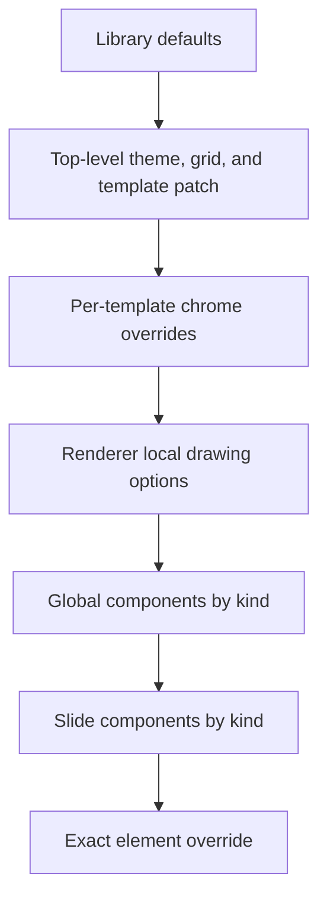

# Responsive configuration and branding

[Documentation index](README.md) · [Component API](components.md) · [Templates](templates.md)

Responsive mode composes seven semantic templates from structured data. It redistributes content at build time rather than preserving the source object tree. The default responsive typography is separate from the full-deck quality profile.

```sh
node src/generate.mjs --mode responsive --config config.example.json
node src/generate.mjs --mode responsive --grid 12x8 --font Arial --show-hidden --output output/grid-12x8.pptx
npm run build:debug
```

## Configuration structure

| Field | Default / purpose |
| --- | --- |
| `slide` | `{width:13.333333,height:7.5}` inches; must remain 16:9 |
| `grid` | `{columns:14,rows:9,gapX:0.12,gapY:0.10}` |
| `theme` | Brand tokens below |
| `template` | Common regions and chrome settings |
| `templates[name]` | Per-template chrome and master settings |
| `components[kind]` | Global component options |
| `slides[source].components[kind]` | Per-slide component options |
| `slides[source].data` | Content patches using the selected template schema |
| `elements['source.id']` | Per-primitive options; highest drawing override layer |
| `assets[key]` | Artwork replacement path and optional tint |

`configure(patch)` recursively merges defaults, clones inputs, and validates positive 16:9 dimensions, six-digit theme colors, and usable header/footer spans. The `Grid` constructor validates track counts and available geometry. Not every unknown responsive key is rejected; consult the documented consumer rather than assuming it is used.

## Precedence and merge semantics



Per-template overrides change `config.template` for region/chrome rendering; they are not a universal component override layer. Canvas drawing options merge local defaults, global component options, slide component options, then exact element options. Objects merge recursively; arrays replace completely. An explicit `box` is an advanced override that can defeat normal layout constraints.

```json
{
  "grid": { "columns": 14, "rows": 9 },
  "components": {
    "strategicPillars": { "gap": 0.24, "minWidth": 2.2, "minColumnSpan": 3 }
  },
  "templates": {
    "executionDashboard": { "showLogo": false }
  },
  "slides": {
    "50": {
      "data": { "mission": "Build lasting client relationships" },
      "components": { "text": { "color": "1E1117" } }
    }
  },
  "elements": {
    "50.pillars.items.0.title": {
      "text": "Grow in priority markets", "fontSize": 18, "align": "center"
    },
    "64.journey.0.steps.0.circle": { "visible": false }
  }
}
```

IDs are recorded in `output/responsive-slides.layout.json`. Primitive text, shape, image, table, and chart methods support their documented visibility settings. Composites do not universally implement their own `visible` flag.

## Brand tokens

Defined in [theme.mjs](../src/theme.mjs):

| `theme.colors` key | Hex | Use |
| --- | --- | --- |
| `primary` | `EC111A` | Brand red, emphasis, bars |
| `text` | `1E1117` | Main text |
| `muted` | `666666` | Secondary labels |
| `paper` | `FFFFFF` | Background and reversed text |
| `surface` | `F5EFE8` | Card/table background |
| `border` | `D8D6CA` | Borders and secondary fills |
| `neutral` | `BCB8A4` | Neutral indicators |
| `complete` | `0070C0` | Completion charts |
| `inProgress` | `D8D6CA` | In-progress chart slices |
| `notStarted` | `EEEEEB` | Not-started chart slices |
| `majorIssues` | `EC111A` | Health status |
| `atRisk` | `FDB913` | Health status |
| `onTrack` | `00A467` | Health status |

| Token group | Defaults |
| --- | --- |
| `fonts` | `body:'Scotia'`, `heading:'Scotia Headline'`, `fallback:'Arial'` |
| `type` | `title:21`, `body:10.5`, `small:9`, `caption:7.5`, `kicker:8` pt |
| `spacing` | `marginX:0.56`, `marginY:0.26`, `gap:0.12`, `padding:0.12` in |
| `line` | `thin:0.5`, `regular:0.8`, `emphasis:1.1` pt |

The fallback token does not itself install or automatically substitute a missing font. Use `--font Arial` for an explicit preview choice. Some renderers set local sizes for specific roles; changing a base token does not replace every local value. Use component/element overrides for those roles, or edit the renderer to consume a new token.

These tokens describe the reference presentation; they are not an official brand manual. Native quality mode has separate typography and flow tokens, and recipes may contain literal source colors. A brand migration must inspect those paths as well as this responsive theme.

## Common template settings

Defaults: `headerRows:1.35`, `footerRows:0.55`, `showNumber:true`, `showLogo:true`, `showGrid:false`, `header:{}`, `footer:{}`. Execution dashboard defaults to `showLogo:false` at its template layer.

`templates[name]` can also supply `logo` (prepared asset key), `masterObjects` (static PptxGenJS object array), and `master` (master-definition overrides). See [Templates](templates.md) for the difference between a semantic renderer and a native Office master.

## Grid and available space

The slide ratio is 16:9; 14 × 9 means layout tracks. Regions are calculated inside outer margins, with header/body/footer spans. Collections choose columns by physical minimum width and optional minimum grid span, then fill rows in reading order. Their cells divide the available height. Extremely dense input can still exceed capacity.

Text and table components shrink within their own documented limits; impossible minimum sizes throw. Responsive templates do not automatically add continuation slides. Changing source data and regenerating runs layout again. Editing the exported PPTX manually does not.

## Artwork

`prepareAssets(config)` scans SVG, PNG, JPEG, and JPG entries in `assets/`, applies replacements, and writes compatible PNGs into `output/assets/`. It returns each prepared asset's path and dimensions. The original assets are not changed.

```json
{
  "assets": {
    "assets/source-50-geometry-4.svg": {
      "path": "assets/source-50-geometry-4.svg",
      "tint": "EC111A"
    }
  }
}
```

Default tint maps source-50 geometry to primary and source-64 geometry to border. SVG tint replaces six-digit literal hex colors. Logos are not automatically tinted. SVG is rasterized at high resolution for responsive reader compatibility; responsive icons are images, not editable Office shapes. EMF and other unscanned media are retained only by the native preservation path. To introduce a new asset key, add a supported file to `assets/` or bind a replacement to an existing key.

## Content example

```js
import { build } from './src/responsive.mjs';

await build({
  theme: { fonts: { body: 'Arial', heading: 'Arial' } },
  slides: {
    50: { data: {
      mission: 'Build lasting client relationships',
      outcome: 'Deliver sustainable growth',
      pillars: [
        { title: 'Grow', icon: 'assets/source-50-geometry-4.svg' },
        { title: 'Simplify', icon: 'assets/source-50-geometry-2.svg' },
      ],
    } },
  },
}, { output: 'output/custom-responsive.pptx', showHidden: true });
```

Only the pillar array is replaced; other source entries remain in the seven-slide build. Use [Validation](validation.md) after changing item count, dimensions, fonts, or content length.
