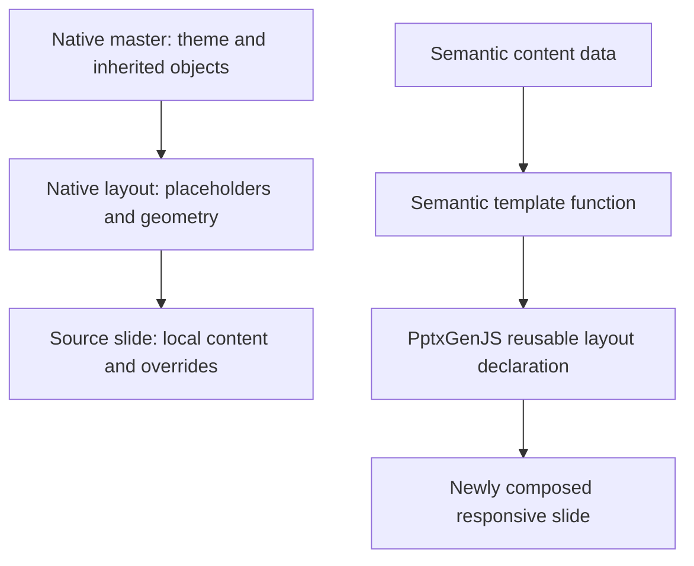

# Templates, masters, and content schemas

[Documentation index](README.md) · [Components](components.md)

## Three meanings of reuse

| Layer | Names | What is reused |
| --- | --- | --- |
| Source variants | `source-001` … `source-071` in `data/templates.json` | Original scene plus native layout/master references |
| Native layouts/masters | `slideLayoutN`, `slideMasterN` | Office inheritance parts, patched by native configuration |
| Semantic templates | Seven names in `src/templates.mjs` | Renderer functions consuming structured data and a body region |



Responsive `defineSlideMaster` declarations are exported by PptxGenJS as reusable layouts connected to master infrastructure; seven declarations do not imply seven independent native `<p:sldMaster>` parts. Static logo and `masterObjects` belong to that reusable layer. Variable title, kicker, source number, notes, and content are drawn per slide.

## Common responsive data

`slides[source].data` recursively patches the corresponding entry in [content.mjs](../src/content.mjs). Arrays replace completely.

| Field | Type | Behavior |
| --- | --- | --- |
| `template` | Registered name | Selects the renderer |
| `title` | String | A `|` separates red topic from black message |
| `kicker` | Optional string | Red upper section label when tags are absent |
| `tags` | Optional string array | Consecutive colored header labels; takes precedence over kicker |
| `footnote` | Optional string | Footer source text |
| `sourceNumber` | Optional number | Displayed number; defaults to source key |
| `hidden` | Optional boolean | Hidden state; execution dashboard defaults to hidden |

Notes are taken from the extracted source and supplemented with a reconstruction note. The build uses fixed source keys `[5,10,21,38,50,64,68]`; setting `selection` does not change this responsive list.

## Header, body, and footer

`regions(config)` creates a grid inside `theme.spacing.marginX/marginY`. `template.headerRows` defaults to 1.35 tracks and `footerRows` to 0.55. The body occupies the remaining tracks. The header/footer spans must be positive and together smaller than grid rows.

`chrome(canvas,data,regions)` draws tags or kicker, a main title, optional number, and footnote. It uses stable IDs such as `header.title`, `header.tag.0.text`, `header.number`, and `footer.source`. `showGrid` draws grid regions. Responsive tag width currently uses a character-count heuristic; quality-mode native ribbons use measured text width. These are separate implementations.

## Template catalog

### `executiveSummary` — source 5

Data: `paragraphs` is an array of extracted rich paragraphs. The renderer preserves paragraph emphasis and uses a single body box. Component kind `executiveSummary`, ID `summary`; defaults `fontSize:10.25`, `minFontSize:8`. Text primitive ID: `summary.content`.

It fits within one responsive slide; it does not use quality-mode continuation pagination.

### `agenda` — source 10

Data: `rows` is a six-column matrix, including header: local time, length, meeting, structure, location, participants. `agenda.table` is a native table. Column weights: `[1.05,0.55,4.05,1.15,2.15,3.4]`; font 9 pt, minimum 6.75 pt, padding 0.035 in. Rows whose meeting starts with Break, Transfer, Free time, or OPTIONAL receive surface fill.

Tune via `components.table` or the `10.agenda.table` element override. Changing column count requires updating the renderer's weights.

### `timeline` — source 21

| Data field | Schema |
| --- | --- |
| `start`, `end` | ISO date strings; define chronological horizontal anchors |
| `months` | `[{label,weeks}]`; weeks weights determine month widths |
| `weeks` | Array of display strings |
| `milestones`, `availability` | `[{date,label,end?,lane?,kind?}]` |
| `committees` | `[{date,text}]`; text lines are date, heading, then body |
| `legend` | Optional display labels |
| `disclaimer` | Optional small header disclaimer |

Component kind/ID `timeline`; defaults `labelRatio:0.13`, `fontSize:7`, `lanes:4`, `gap:0.10`, `committeeMinWidth:1.7`; optional `labelWidth` defaults to 1.3 in when rendering events. Event lanes default to index modulo lane count. Use valid zero-based lanes below `lanes`. Dates are clamped to the interval. Neighbor midpoints constrain labels; duration lines use `end`. Kinds `meeting`, `board`, and `review` select marker styles/colors. Source committee text intentionally contains “SteerCo #4” twice.

### `competitiveComparison` — source 38

Data: `rows` is the original seven-column comparison matrix, `logos` supplies six asset keys, `banks` holds reference bank names, and `footnote` supplies the source. Rendering uses `rows` and `logos`; `banks` is retained data, not a separate rendered label source.

The body splits 11% logos / 89% table. Weights `[1.4,1,1,1,1,1,1]` align logos and columns. `comparison.table` uses 9.5 pt, minimum 7, padding 0.06 in, no generated header. `comparison.highlight` frames the source bank. Table overrides control cells and row styles.

### `strategicPillars` — source 50

Data: `mission`, `outcome`, `pillars:[{title,icon}]`. Mission/outcome become red bands; pillars wrap between side rails.

| Component option | Default |
| --- | --- |
| `bandRatio` | 0.11 |
| `padding` | 0.38 in |
| `gap` | 0.24 in |
| `minWidth` | 2.2 in |
| `minColumnSpan` | 3 tracks |
| `fontSize` | 19 pt |
| `iconRatio` | 0.20 |

Kind `strategicPillars`, ID `pillars`. Child IDs: `pillars.items.0.background`, `.icon`, `.title`; bands: `pillars.band.0.text` and `.1.text`. More items wrap, subject to available height and minimum title size.

### `clientJourney` — source 64

Data: `journeys:[{title,description,steps:[{title,description,icon,accent?,channel?}]}]`, plus `discussion`. Steps are ordered left to right and wrap within each lane. Neighbor connectors are only drawn for steps in the same visual row.

Kind `clientJourney`, ID `journey`; defaults `labelWeight:1.6`, `contentWeight:10`, `gap:0.12`, `minStepWidth:1.3`, `iconRatio:0.25`, `fontSize:9`. Step collections also reserve at least two grid columns. Accent steps and the VIRTUAL / BRANCH step receive assisted-channel text by default. `channel` replaces the inferred label.

IDs: `journey.0.label.heading`, `journey.0.steps.0.circle`, `.icon`, `.channel`, `.title`, `.description`, plus `journey.discussion.text`.

### `executionDashboard` — source 68

Data: `pillars:[{title,health,chart,accomplishments,concerns}]`.

`health` has five values ordered Major Issues, At Risk, On Track, Not Started, Completed. `chart` is `{labels,values}` with three metric values and the white spacer. Accomplishments/concerns are rich-paragraph arrays; the first paragraph is the section heading, remaining paragraphs form the body.

Kind `executionDashboard`, ID `dashboard`; defaults `gap:0.30`, `minWidth:3.25`, `minColumnSpan:4`, `fontSize:10.5`, `chartFontSize:8`. Each `dashboard.pillars.i` uses a panel, five health rows, a native doughnut, accomplishments, and concerns. `templates.executionDashboard.showLogo` defaults to false. The source is hidden unless explicitly shown.

## Configuring reusable chrome and masters

```json
{
  "template": { "showLogo": true, "showNumber": true, "footerRows": 0.55 },
  "templates": {
    "strategicPillars": {
      "headerRows": 1.35,
      "logo": "assets/logo.svg",
      "masterObjects": [],
      "header": { "fontSize": 21 },
      "footer": { "color": "666666" }
    }
  }
}
```

`templates[name]` is merged into `config.template` before region calculation. It supports common chrome settings plus `logo`, `masterObjects` (PptxGenJS master object array), and `master` (additional `defineSlideMaster` options). Static objects belong in the master declaration; dynamic objects belong in the renderer. Native full-deck template configuration instead uses `slideLayoutN` keys, as described in [Native configuration](configuration.md).
