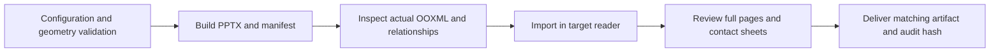

# Validation and troubleshooting

[Documentation index](README.md)

Validation has three layers: deterministic layout checks, verification of the exported package, and visual review in the intended reader. Passing one layer does not replace the others.



## Automated checks

```sh
npm test
npm run docs:check
npm run build
npm run verify
```

The test suite covers geometry bounds, reading order, wrapping, configuration overrides, typography limits, impossible font increases, summary preservation and pagination, agenda content, native chart data, workbook correctness, and reader-compatibility repairs. Consult [tests/](../tests/) for exact assertions; test counts can grow with the project.

`docs:check` scans named JavaScript functions/methods for preceding JSDoc and Python functions for docstrings. It checks presence, not language, parameter accuracy, or prose quality. It writes `output/documentation-report.json`; its output directory must exist, as it does after a build.

`verify.py` reads the actual PPTX ZIP and its sibling manifest. Native checks inspect selection/order, 16:9 dimensions, package relationships, hashes, and configured changes. Unchanged fidelity requires source visual/binary part equality. The full quality verifier additionally expects the repository's 26 active charts and zero estimated overflow. This source-specific count means a custom subset or materially different source may require an adapted verifier.

Responsive verification is source-specific: seven slides, two native tables, three native charts, original key content, chart values, and on-canvas bounds. It expects the stock semantic data, so intentional content changes can invalidate its content assertions.

```sh
# Verify a nondefault output filename
python3 scripts/verify.py output/reviewed-slides.pptx

# Verify stock responsive output
python3 scripts/verify.py output/responsive-slides.pptx
```

## LibreOffice visual review

```sh
python3 scripts/review_quality.py --source output/recreated-slides.pptx --directory output/review/quality-final
```

Requires `soffice`, `pdftoppm`, and Pillow. It exports a PDF, rasterizes pages, creates contact sheets in reading order, checks page count, and records the unchanged PPTX hash. The manifest must be from a quality build. Review labels distinguish output page and source slide, including continuations.

Use a fresh review directory for each materially different run to avoid stale images from earlier, longer decks. Contact sheets help detect repeated alignment errors; inspect full-resolution pages for padding, clipping, small footnotes, and chart labels.

## Keynote verification

```sh
python3 scripts/review_keynote.py --source output/recreated-slides.pptx --directory output/review/keynote
```

Requires macOS and Keynote. The script opens a private temporary PPTX copy, compares imported slide count and native chart count with the manifest, exports `validated.pdf`, and records application version and artifact SHA-256 in `review-report.json`. It closes only its temporary document without saving. Existing user documents are not saved or closed.

A chart-count match proves chart objects survived import; it does not prove every label, axis, or font renders identically. Review the Keynote PDF after the count check. Generated chart data labels can differ between Keynote and other readers even when the chart data and native objects are intact.

## Baseline pixel comparison

```sh
npm run build:fidelity
npm run verify:visual
```

`visual_review.py` renders visible temporary copies of the reference and candidate with the same LibreOffice environment, including originally hidden slides. It compares pixels and records hashes. Use it for the source-preservation baseline. Quality changes typography, layout, and pagination intentionally; comparing that output against the original as a pixel-equality target is inappropriate.

## Delivery review criteria

Check complete pages for content overlap, clipping, consistent padding, icon-to-text gaps, aligned peer headers, readable notes, footer/logo clearance, and correctly rendered chart bars/lines. Confirm charts contain the expected values and remain editable in the target application. Confirm covers use display typography and continuation pages preserve all source wording. Keep the PDF/report hash associated with the exact PPTX reviewed.

## Troubleshooting

| Symptom | Likely cause | Action |
| --- | --- | --- |
| Charts appear empty in Keynote | Invalid generated workbook ranges or legacy XLSB dependency | Use quality mode; inspect `workbookRepairs`; run Keynote import and review its PDF |
| Chart labels differ while charts import | Reader-specific label formatting | Inspect target reader; adjust native chart options or explicit annotation objects without replacing the chart |
| Mexico ribbon is too long/short | Native quality flow disabled, stale output, or responsive heuristic | Rebuild quality with `flow.enabled:true`; inspect manifest and output hash; responsive chrome has separate behavior |
| Body text overlaps footer/logo | Incorrect source-specific region, insufficient content area, or explicit box override | Inspect `layoutConstraints`; adjust region/bindings and footer clearance, then rebuild |
| Text still fails at minimum size | Content exceeds useful area | Increase region, reduce content density, or add an explicit continuation strategy; do not bypass strict delivery checks |
| Covers look like body text | Missing hierarchy role or profile disabled | Check `coverTitle` / `sectionCoverTitle`, source typography metadata, and explicit role assignments |
| Text appears inverted in a small box | Margins exceed useful height or vertical orientation import issue | Use quality's bounded insets and vertical table-label materialization; inspect explicit overrides |
| Icon covers a tactic label | Icon/text association missing or column changed | Check `flow.tableIcons`, text column, icon size, and gap |
| An override has no effect | Wrong contract, ID, or precedence layer | Use native IDs for original objects, quality declaration IDs for repair overrides, responsive IDs for Canvas objects |
| Font change from CLI disappears | `quality.font` normalizes after theme substitution | Set `quality.font` explicitly |
| Changing grid has no visible effect | Preserved source geometry | Use explicit `grid` patches, native flows, or semantic responsive templates |
| Local dependencies cannot resolve | npm installation missing or runtime fallback unavailable | Run `npm install`; inspect `CODEX_NODE_MODULES` only when using a known bundled runtime |
| Unknown parameter error | Responsive setting supplied to native mode, or unsupported native key | Use the mode-specific configuration reference |

## Limits

Fonts are not embedded. Measurement primarily uses Arial advances. Baseline byte equality preserves existing source defects as well as source artwork. Quality constraints address known component families and do not perform unrestricted semantic collision detection. Manual editing after export does not trigger responsive layout. A new source deck requires reclassification, updated bindings, and new visual evidence.
